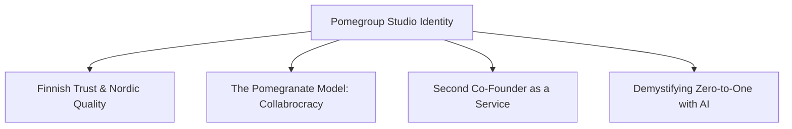

# Module 00: Company Profile & Corporate Identity

> **Single Source of Truth: Legal, Founder, Brand, and Philosophy**  
> **Entity:** Smart Monshi Oy / Pomegroup Studio

---

## 1. Corporate & Legal Facts

| Field | Value | Notes |
| :--- | :--- | :--- |
| **Legal Name** | **Smart Monshi Oy** | Registered with Finnish Trade Register (PRH) |
| **Auxiliary Trade Name** | **Pomegroup Studio** | Primary commercial and brand identity |
| **Business ID (Y-tunnus)**| **3370210-5** | Official Finnish tax & company identification |
| **Registered Industry** | Management Consulting (*Liikkeenjohdon konsultointi*, TOL 70220) | Covers business development, technical architecture & venture building |
| **Registered Address** | Saariselänkuja 2 D 51, 00970 Helsinki, Finland | Official domicile: Helsinki |
| **Incorporation Year** | 2023 | Domiciled in Finland |
| **Primary Website** | [https://pomegroup.studio](https://pomegroup.studio) | Main portal |
| **Founder & Managing Director**| **Mahdi Farimani** | Serial entrepreneur, tech builder & product strategist |
| **Primary Contact Email** | `admin@pomegroup.studio` | Google Workspace primary administrator & founder email |

---

## 2. Origin Story & Core Philosophy

### The Pomegranate Metaphor (13 Years in the Making)
The foundational concept of Pomegroup was envisioned **13 years ago** by Mahdi Farimani. 
The pomegranate serves as a structural metaphor:
* **The Seeds:** Distinct, independent domain experts, specialists, and ventures.
* **The Membrane & Husk:** The unified studio ecosystem, shared infrastructure, AI automation tools, and strategic execution framework that holds them together.

Pomegroup is designed as an **autonomous builder studio**—bringing together experienced specialists who operate with individual autonomy while leveraging collective momentum to build impactful, scalable ventures.

### From Smart Monshi to Pomegroup Studio
Upon relocating to Finland, Mahdi initially incorporated the company to develop **Monshi.live**—an intelligent AI meeting assistant (*"Monshi"* means secretary/assistant in Farsi). As the company evolved and the demand for holistic venture co-building grew, the studio expanded beyond a single product. The company established the auxiliary business name **Pomegroup Studio**, returning to the overarching pomegranate vision of a venture builder and incubator.

---

## 3. Founder Background — Mahdi Farimani

Mahdi is a **serial co-founder and venture builder**, combining technical product engineering, executive management, and growth strategy.

### Education
* **MBA** — **Sharif University of Technology** (Tehran, Iran)
  * Iran's premier institution for engineering, technology, and management.
  * Specialized in technology management, platform strategy, and organizational growth.

### Track Record & Prior Ventures
| Role | Entity | Description & Impact |
| :--- | :--- | :--- |
| **Co-Founder (Exited)** | **DadPardaz** | Pioneer legal services marketplace and digital advisory platform in Iran. Exited (handover completed October 2026; archived). |
| **Co-Founder** | **Bemehrbani** | Social impact and transparent crowdfunding platform for vulnerable populations. |
| **Co-Founder** | **Mehrbaran** | Philanthropic platform facilitating charitable resource distribution. |
| **Co-Founder (Exited)** | **HRCando** | The leading Applicant Tracking System (ATS) and enterprise HR tech suite in Iran. Successfully exited. |
| **Co-Founder (Exited)** | **TaFarda Studio** | Corporate venture studio owned by Iran's largest automotive component manufacturing group. Successfully exited. |
| **IT Project Manager** | **Hamshahri Newspaper** | Managed core digital systems and infrastructure for the highest circulated daily newspaper in Iran. |

---

## 4. Brand Positioning & Core Pillars

1. **Nordic Reliability & Trust:** Operating under Finnish corporate governance, absolute transparency, strict data privacy (GDPR), and uncompromising product quality.
2. **"Collabrocracy" (Not an Agency):** We do not sell billable hours or perform commodity outsourcing. We enter deep partnerships as co-founders, aligning incentives through equity and shared success.
3. **Resource Asymmetry via AI Automation:** Leveraging autonomous AI workflows (AntiGravity, Loop Engineering) to produce the engineering, research, and operational output of a 10-person agency with a lean, agile core.
4. **Demystifying 0→1:** Taking ideas from napkin sketches to validated, revenue-generating, or funded European entities in record time.
