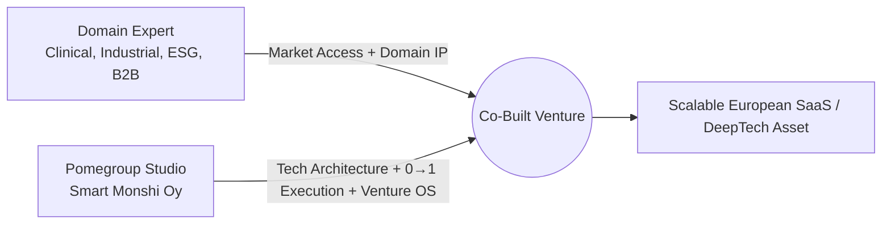
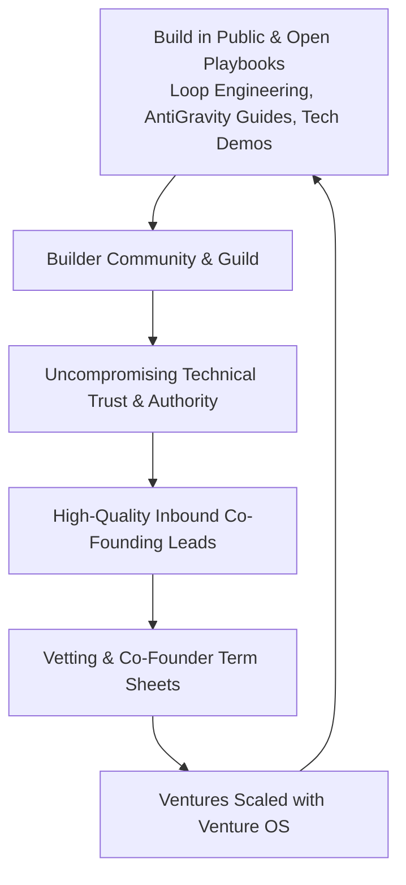

# Module 01: Business Model & Studio Mechanics

> **Single Source of Truth: Value Proposition, Monetization, ICP, and Venture OS**  
> **Entity:** Smart Monshi Oy / Pomegroup Studio

---

## 1. Value Proposition: "Second Co-Founder as a Service"

Traditional agencies charge massive cash fees for fragmented code deliverables, leaving founders stranded without ongoing technical leadership. Traditional accelerators take equity but offer only advice and mentorship, leaving execution entirely to the founders.

**Pomegroup Studio operates in the missing middle:**
* We step in as the **Technical, Product, and Operational Co-Founder**.
* We handle the entire **0 → 1 journey**: product architecture, UI/UX design, full-stack implementation, AI engine integration, legal incorporation, and go-to-market testing.
* We align our success with the venture through **equity stakes and shared growth milestones**.

---

## 2. Dual Revenue Engines

Pomegroup balances rapid cash flow generation with exponential enterprise equity value:

### Engine A: Long-Term Enterprise Value (Equity Partnerships)
* **Equity Stakes (15% – 35%):** Taken in co-founded ventures (e.g., ExecutESG, ONTON, FelixGuide).
* **Capital Efficiency:** High-speed MVP delivery enables ventures to achieve early traction, secure non-dilutive public grants (Business Finland, TE Office Starttiraha), or raise pre-seed capital (e.g., FelixGuide’s €200k raise) with minimal dilution.

### Engine B: Near-Term Cash Flow & Retainers (Company-as-a-Service & Advisory)
* **Monthly Strategic Retainers:** Fixed monthly engineering and advisory fees for ongoing technology leadership.
* **Company-as-a-Service (Rhinograph):** Proxy representation, Finnish board membership service, corporate governance, and statutory PRH/Vero compliance for international founders (€300/mo base retainer + incorporation setup fees).
* **Relocation & Business Expansion Advisory:** Structured immigration and commercial entry consulting for foreign entrepreneurs targeting Finland (Start-Up Permit, Entrepreneur Permit, Specialist Visa) and Turkey (Work Permit / EOR).

---

## 3. Ideal Partner Profile (ICP)

Pomegroup collaborates with a very specific founder persona:

| Trait | What We Look For | Why It Matters |
| :--- | :--- | :--- |
| **Domain Mastery** | Deep subject-matter authority (e.g., Dentists, Metallurgists, ESG Auditors, Logistics Operators). | Proprietary industry insight and unfair domain knowledge cannot be easily replicated. |
| **Market Access** | Existing professional networks, qualified enterprise pilot leads, or immediate industry demand. | Dramatically reduces customer acquisition costs (CAC) from Day 1. |
| **Execution Need** | The founder lacks the technical capability, product design experience, or European corporate scaffolding to execute alone. | Creates perfect symbiosis with Pomegroup's Venture OS and AI-driven development. |
| **Integrity & Drive** | High resilience, coachability, and shared values. | Co-founding is a multi-year partnership requiring total trust. |

---

## 4. The Studio Flywheel & "Build in Public"

Pomegroup's go-to-market engine runs on an **open-source, education-first community model**:

* **North Star Metric:** *Active Builders Empowered* — prioritizing the number of founders, creators, and engineers utilizing our frameworks.
* **Inbound Conversion:** Educating builders generates organic trust, which natively converts into high-caliber technical co-founding opportunities without outbound ad spend.

---

## 5. The "Venture OS" Infrastructure

To incubate multiple ventures without technical debt, Pomegroup standardizes product delivery into a reusable operating system:

1. **Scaffolding Under 48 Hours:** Universal application boilerplate (Next.js 16 + React 19 + TypeScript + Tailwind CSS v4 + Supabase/Neon/Cloudflare D1).
2. **AI Automation Harness:** Multi-agent development loops (AntiGravity SDK + Loop Engineering) that automate testing, triage, and rapid prototyping.
3. **Nordic Regulatory Blueprint:** Standardized templates for Finnish PRH registration, bank account onboarding, VAT (ALV) setup, and immigration compliance.
