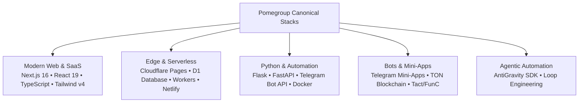

# Module 03: Tech Stack & Architecture

> **Single Source of Truth: Frameworks, Infrastructure, Coding Standards & Security**  
> **Entity:** Smart Monshi Oy / Pomegroup Studio

---

## 1. Monorepo Architecture

The Pomegroup repository is structured as a **hybrid multi-venture monorepo**:
* **Autonomous Projects:** Each project inside `Projects/` and `pomegroup-website/` maintains its own dependencies (`package.json` / `requirements.txt`) and build configurations.
* **No Heavy Monorepo Tooling:** Eliminates cross-project dependency locking and fragile monorepo tooling (no lerna/turborepo lock-in). Each directory can be deployed independently to its own infrastructure (Cloudflare, Netlify, Vercel, VPS).
* **Shared Context:** All projects share the central `context/` layer, git history, and agent configuration rules.

---

## 2. Canonical Technology Stacks

### Stack A: Modern Web & SaaS (Default Tier)
* **Framework:** Next.js 16 (App Router), React 19
* **Language:** TypeScript 5 (Strict mode)
* **Styling:** Tailwind CSS (v4 preferred)
* **Database & ORM:** Neon Database (Serverless PostgreSQL) / Supabase / Prisma ORM
* **UI & Icons:** Lucide React, Radix UI primitives
* **Usage:** `pomegroup-website`, `Projects/FelixGuide`, `Projects/Expertshub`, `pometesters`

### Stack B: Edge & Serverless (Ultra-Low Latency / Validation MVP)
* **Hosting:** Cloudflare Pages
* **Database:** Cloudflare D1 (Serverless SQLite at the edge)
* **Functions:** Cloudflare Pages Functions (`functions/api/`)
* **Styling:** Vanilla Glassmorphism HTML5/CSS3 / Tailwind
* **Usage:** `Projects/nordbot`, Netlify-hosted portals (`Projects/TurkeyWorkPermit`)

### Stack C: Python Services, Bots & Resilient Networking
* **Core Language:** Python 3.11+
* **Frameworks:** Flask / FastAPI
* **Bot APIs:** `python-telegram-bot`
* **Security & Crypto:** Fernet symmetric encryption (`cryptography`), Tor `.onion` routing
* **Containerization:** Docker & Docker Compose
* **Usage:** `Projects/juuri`, `Projects/Peyvand`, `Projects/GSME Alumni`

### Stack D: Telegram Mini-Apps (TMA) & Web3
* **Runtime:** Telegram WebApp SDK
* **Blockchain:** TON (The Open Network)
* **Smart Contracts & Tooling:** Tact, FunC, `@ton/blueprint`, Ston.fi DEX integrations
* **Usage:** `ONTON`, `ChallenQuiz`, `Greenlight`

---

## 3. Mandatory Engineering Standards

All contributors and AI coding agents must strictly adhere to these standards:

### 1. Code Style & Typing
* **Strong Typing:** Always use explicit types in TypeScript. The use of `any` is strictly prohibited. Use proper generics and interfaces.
* **Modern JavaScript:** Always prefer `const` over `let`. Never use `var`.
* **Single Responsibility:** Keep functions small, testable, and focused on one clear action.
* **Zero Placeholders:** Never commit or output lazy placeholder code (e.g., `// ...rest of code remains the same` or `/* TODO: implement later */`). Always write complete, functional blocks.

### 2. Security & Secrets Management
* **Never Hardcode Secrets:** API keys, database credentials, and auth tokens must strictly reside in `.env.local` or platform secret vaults (Cloudflare Secrets, Netlify Environment Variables).
* **Sample Configurations:** Always provide a sanitized `.env.example` when introducing new environment dependencies.
* **Zero Client-Side Leaks:** Sensitive tokens (e.g., Cloudflare API tokens, bot tokens, private keys) must never be bundled into client-facing bundles.

### 3. Verification Before Completion
* **Self-Verification:** Never declare a task or feature complete without verifying that the application builds cleanly (`npm run build`, `npm run lint`, or running Python syntax/unit tests).
* **Test Failure Assumption:** If an automated test fails after writing code, always assume the root cause is the newly written implementation, not the test harness itself.

---

## 4. Strict Anti-Fabrication & Truthfulness Directive

* **Zero Synthetic Fabrication of People:** NEVER generate AI images, place synthetic headshots, or fabricate photos/avatars for real living people, team members, or partners.
* **No Guessing Personal Data or URLs:** NEVER invent, fabricate, or assume social media profiles, handles, personal contact numbers, or biographical facts. If information is not documented in the repository, pause and verify.
* **Exhaustive Disk Search First:** Before concluding that an asset, document, or logo is missing, always search sibling project directories and the `archive/` folder on disk.
