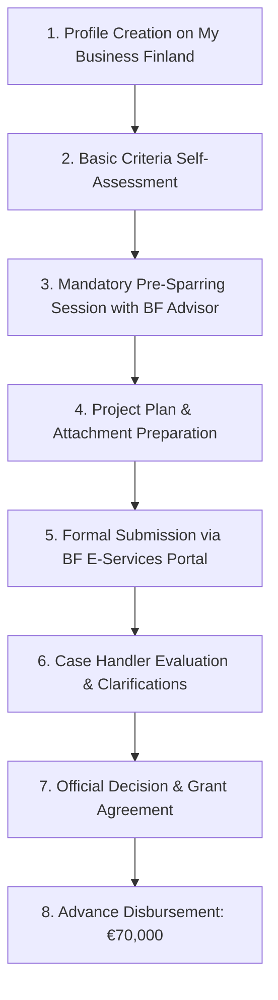
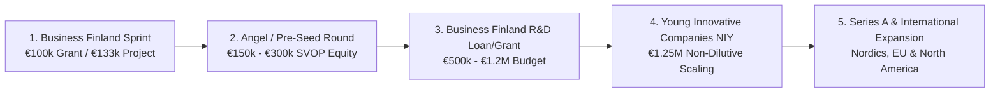

# Module 05: Business Finland Sprint Funding Knowledge Base

> **Canonical Knowledge Base: Sprint Grant Framework, Legal Precedents, Accounting Standards & Venture Studio Application Engineering**  
> **Entity:** Smart Monshi Oy / Pomegroup Studio (Helsinki, Finland)  
> **Effective Date:** September 1, 2026 (Permanent Continuous Call)  
> **Supersedes:** Discontinued Tempo Grant Guidelines (Closed October 2025) & Sprint Pilot Guidelines (March–August 2026)

---

## 1. Executive Summary & Legal Framework

In early 2026, **Business Finland** (the Finnish government's innovation funding agency operating under the Ministry of Economic Affairs and Employment — *TEM / Työ- ja elinkeinoministeriö*) completely overhauled its early-stage startup funding architecture. The longstanding **Tempo Grant** (which provided up to €50,000 for early market validation) was formally phased out in late 2025. 

To bridge the gap between initial ideation and large-scale industrial R&D, Business Finland launched the **Sprint Funding Program** (*Sprint-rahoitus / Sprint-avustus nopeaa kansainvälistä kasvua hakeville pienille yrityksille*).

Following a successful pilot running from **March 2 to August 31, 2026**—which processed over 200 applications and validated high market demand—Business Finland permanently instituted Sprint as a **continuous open call starting September 1, 2026**.

```
┌─────────────────────────────────────────────────────────────────────────────────────────┐
│                           BUSINESS FINLAND FUNDING EVOLUTION                            │
├────────────────────────────────┬────────────────────────────────────────────────────────┤
│ Legacy Instrument              │ Modern Instrument (Active from September 1, 2026)      │
├────────────────────────────────┼────────────────────────────────────────────────────────┤
│ Tempo Grant                    │ Sprint Grant                                           │
│ • Max Grant: €50,000           │ • Max Grant: €100,000 (Min: €75,000)                   │
│ • Project Budget: €66,667      │ • Project Budget: €100,000 – €133,334                  │
│ • Aid Intensity: 75%           │ • Aid Intensity: 75%                                   │
│ • Capital Barrier: €30,000     │ • Capital Barrier: €50,000 in Paid-In Equity (SVOP/Cap)│
│ • Advance: 70% (€35,000)       │ • Advance: 70% (€70,000 for <5yo startups)             │
│ • Focus: Testing/Validation    │ • Focus: 2/3 Technical R&D + 1/3 Market Validation     │
└────────────────────────────────┴────────────────────────────────────────────────────────┘
```

### Statutory Legal Basis
All funding decisions, cost acceptances, and audit rights under Sprint funding are governed by Finnish national and EU legislation:
1. **Act on Discretionary Government Transfers (*Valtionavustuslaki 688/2001*)**: Sections 11 (3 & 4), 12, 13, and 21–26 (clawback, audit rights, and discretionary authority).
2. **Act on the General Conditions for Aid for Economic Activities (*Laki taloudelliseen toimintaan myönnettävän tuen yleisistä edellytyksistä 429/2016*)**.
3. **Government Decree on the Funding of Research, Development and Innovation Activities (*Valtioneuvoston asetus tutkimus-, kehitys- ja innovaatiotoiminnan rahoituksesta 1444/2014 / TKI-asetus*)**: Section 2 specifically defines eligible research and development activities.
4. **EU De Minimis Regulation (*Commission Regulation (EU) No 2023/2831*)**: Governs small-scale state aid limits (maximum €300,000 per single undertaking over any 3-year rolling period).
5. **Finnish Public Procurement Act (*Laki julkisista hankinnoista ja käyttöoikeussopimuksista 1397/2016*)**: Mandatory compliance when public support exceeds 50% of the project budget (Sprint provides 75%).
6. **Finnish Limited Liability Companies Act (*Osakeyhtiölaki 624/2006*)**: Specifically Chapter 12 governing Capital Loans (*Pääomalaina*) and Chapter 8/13 on Invested Unrestricted Equity Reserve (*SVOP-rahasto*).

---

## 2. Core Parameters & Financial Mechanics

Sprint is a **non-repayable, non-dilutive discretionary grant**. The Finnish state takes zero equity, zero board seats, and zero royalties.

### Financial Summary Matrix

| Metric | Specification | Verification Rule |
| :--- | :--- | :--- |
| **Grant Amount** | **€75,000 – €100,000** | Scaled strictly at 75% of accepted project budget. |
| **Aid Intensity** | **75%** of eligible project costs | Remaining 25% must be covered by applicant's private cash. |
| **Project Budget** | **€100,000 – €133,334** | Budgets exceeding €133,334 are permitted, but maximum grant is capped at €100,000. |
| **Aid Classification** | **De Minimis Aid** | Cumulative cap of €300,000 across all public entities over rolling 3-year period. |
| **Project Duration** | **6 to 12 months** | Defined in application Gantt chart; extensions require prior written request. |
| **Advance Payment (<5yo)** | **70% (€70,000)** | Paid upfront after funding decision acceptance for companies < 5 years old. |
| **Final Reimbursement (<5yo)**| **30% (€30,000)** | Paid upon project completion, final report, and independent auditor confirmation. |
| **Disbursement (≥5yo)** | **0% Advance / 100% In Arrears** | Older companies receive 0 advance; 100% paid post-completion against verified costs. |
| **Public Procurement Limit** | **€60,000 (excl. VAT)** | Individual subcontracts ≥ €60,000 must be tendered via public portal HILMA. |
| **Direct Salary Cap** | **€4,000 / month gross** | Applies to any founder or team member holding ≥ 10% company shares. |
| **Indirect Overhead Rates** | **30% Indirect Personnel + 10% Other** | Flat calculated rates; no receipts required for the 10% "Other Costs". |

---

## 3. Strict Eligibility Matrix & Gatekeepers

Before Business Finland reviews the commercial innovation or scientific merit of an application, the company must pass through five immutable statutory gatekeepers. A failure in any single gatekeeper triggers an immediate formal rejection (*hylkäyspäätös*).

```
┌─────────────────────────────────────────────────────────────────────────────────────────┐
│                          SPRINT 5-STAGE GATEKEEPER PIPELINE                             │
└─────────────────────────────────────────────────────────────────────────────────────────┘
                                       │
                                       ▼
┌─────────────────────────────────────────────────────────────────────────────────────────┐
│ 1. CORPORATE STRUCTURE & REGISTRATION                                                   │
│ • Finnish Oy (Osakeyhtiö) with active Y-tunnus                                          │
│ • EU SME / Micro-Enterprise (<50 FTE, <€10M balance/turnover)                           │
│ • Mainland Finland domicile (Åland excluded unless permanent mainland establishment)    │
└─────────────────────────────────────────────────────────────────────────────────────────┘
                                       │
                                       ▼
┌─────────────────────────────────────────────────────────────────────────────────────────┐
│ 2. THE €50,000 PAID-IN RISK EQUITY RULE                                                 │
│ • Minimum €50,000 injected in cash as Share Capital, SVOP, or OYL Ch 12 Capital Loan    │
│ • Registered on balance sheet no older than 2 months                                    │
│ • Retained earnings only accepted for established companies ≥ 5 years old               │
└─────────────────────────────────────────────────────────────────────────────────────────┘
                                       │
                                       ▼
┌─────────────────────────────────────────────────────────────────────────────────────────┐
│ 3. LIQUIDITY & NET FINANCIAL ASSETS TEST                                                │
│ • Net Financial Assets = Cash + Short-Term Receivables - Short-Term Debts               │
│ • Startups (<5yo): Minimum €63,334 available liquidity                                  │
│ • Established SMEs (≥5yo): Minimum €133,334 available liquidity                        │
└─────────────────────────────────────────────────────────────────────────────────────────┘
                                       │
                                       ▼
┌─────────────────────────────────────────────────────────────────────────────────────────┐
│ 4. TWO-PERSON COMMITTED TEAM IN FINLAND                                                 │
│ • Minimum 1 Full-Time person (100% dedicated, zero outside employment)                  │
│ • Minimum 1 Full-Time Equivalent (1 FTE or two 50% part-time contributors)              │
│ • Physically based and working in Finland (work permit / EU residency verified)         │
└─────────────────────────────────────────────────────────────────────────────────────────┘
                                       │
                                       ▼
┌─────────────────────────────────────────────────────────────────────────────────────────┐
│ 5. PRIOR FUNDING & DE MINIMIS CLEARANCE                                                 │
│ • Startups (<5yo): Zero prior Business Finland R&D, Tempo, Sprint, NIY, or DTA grants   │
│ • All applicants: Total de minimis aid under €300,000 over rolling 3-year period        │
│ • Not an "Undertaking in Difficulty" under EU state aid law                             │
└─────────────────────────────────────────────────────────────────────────────────────────┘
```

### Gatekeeper 1: Corporate Structure & Size Classification
* **Permitted Legal Entity:** Private Limited Liability Company (*Osakeyhtiö / Oy*) registered in the Finnish Trade Register (*Kaupparekisteri*).
* **Excluded Entities:** Sole proprietorships (*toiminimi / yksityinen elinkeinonharjoittaja*), general partnerships (*avoin yhtiö*), limited partnerships (*kommandiittiyhtiö*), cooperatives (*osuuskunta*), associations (*yhdistys*), foundations (*säätiö*), and public entities.
* **Size Test:** Must meet EU Small or Micro-enterprise criteria:
  * Headcount: `< 50` full-time equivalent employees.
  * Financials: Annual turnover or balance sheet total `< €10,000,000`.
  * *Affiliation Check:* If the company is linked to or owned (>25% or >50%) by a parent or corporate group, the headcount and financials are consolidated across the entire enterprise tree.

### Gatekeeper 2: The €50,000 Paid-In Risk Equity Requirement
This is the most strictly scrutinized balance sheet prerequisite:
* **The Rule:** The applicant must prove that **at least €50,000 of private risk equity** has been invested into the company in cash at some point in its corporate history and is recorded on the balance sheet.
* **Eligible Instruments:**
  1. **Share Capital (*Osakepääoma*):** Registered share capital paid in cash.
  2. **Invested Unrestricted Equity Reserve (*SVOP / Sijoitetun vapaan oman pääoman rahasto*):** Equity investments injected by founders, business angels, or venture studios without issuing formal nominal share capital.
  3. **Capital Loans (*Pääomalaina*):** Subordinated loans strictly structured according to **Chapter 12 of the Finnish Limited Liability Companies Act (*OYL 12 luku*)**. In the event of bankruptcy, a capital loan is subordinated to all other corporate creditors and cannot carry collateral.
* **Exclusions & Ineligible Capital:**
  * Standard bank loans, Finnvera loans, or founder loans with repayment obligations do **not** count.
  * For companies `< 5 years old`, accumulated profits / retained earnings (*kertyneet voittovarat*) do **not** count as newly injected risk capital.
  * *September 2026 Policy Update for Companies ≥ 5 Years Old:* In the continuous call opening September 1, 2026, companies aged 5 years or older **can** count retained earnings shown in approved financial statements of the last full fiscal year toward the €50,000 equity requirement.
* **Unclosed Funding Rounds:** If the €50,000 equity has not yet cleared the bank account at submission, Business Finland may accept a **signed investment commitment or formal term sheet** from an accredited investor, provided proof of transfer is submitted prior to the funding decision entering into force.

### Gatekeeper 3: Liquidity & Net Working Capital Test
Business Finland will not fund an insolvent venture or one that will collapse mid-project. They calculate the company's **Net Financial Assets (*Nettorahoitusvarat*)**:
$$\text{Net Financial Assets} = \text{Cash and Bank Equivalents} + \text{Short-Term Receivables} - \text{Short-Term Liabilities}$$
* **Startups (< 5 years old):** Must prove **at least €63,334** in available liquidity at the time of application.
  $$\text{Required Project Cash} = \text{Total Project Budget (€133,334)} - \text{Advance Payment (€70,000)} = \text{€63,334}$$
* **Established SMEs (≥ 5 years old):** Must prove **at least €133,334** in available liquidity, as zero advance funding is disbursed.
* **Operational Burn Buffer:** If the company incurs ongoing operational burn outside the project (e.g. non-project staff, existing client operations), the company must demonstrate sufficient additional working capital to cover those external costs for the duration of the project.

### Gatekeeper 4: The 2-Person Committed Team in Finland
* **Core Rule:** The company must have an active, credibly committed operational team of **at least two individuals residing and working in Finland**.
* **Full-Time Mandate:** At least **one person must work 100% full-time** for the applicant company. They cannot hold another full-time job, executive directorship elsewhere, or academic appointment requiring standard working hours.
* **Second Person Equivalence:** The second full-time equivalent (FTE) can be fulfilled either by:
  * A second 100% full-time person, OR
  * Two part-time team members each dedicating at least 50% of their verifiable working hours.
* **Commitment Verification:** Credible commitment is demonstrated by holding a significant shareholding (e.g., >10–20%), an executive employment contract, or a formal management services agreement.
* **Founders Drawing Zero Salary:** An entrepreneur's own working hours are recognized as project human resources even if they do not draw an immediate cash salary (e.g., living on Starttiraha or personal savings). However, only actual paid salaries subject to withholding tax can be claimed for financial grant reimbursement.

### Gatekeeper 5: Prior Funding & De Minimis Rules
* **Prior Grant Ban for Startups (< 5 years):** A company under 5 years old is **permanently barred** from Sprint if it or any company in its corporate group has previously received:
  * Business Finland Sprint
  * Business Finland Tempo (or ESA-BIC incubator equivalent)
  * Business Finland R&D Funding (*Tutkimus- ja kehitysrahoitus*)
  * Young Innovative Companies (*Nuoret innovatiiviset yritykset / NIY*)
  * Deep Tech Accelerator (DTA)
* **Spin-Off Exemption (New September 2026 Rule):** A newly incorporated venture spinning out from a large or midcap corporation is eligible for Sprint even if the parent received Business Finland funding for the technology, provided the parent holds **strictly less than 25% ownership** and exercises **zero corporate control**.
* **Companies ≥ 5 Years Old:** Prior funding does **not** bar an established SME, provided the previous funding was not awarded for the exact same technological solution.
* **De Minimis Limit:** Under Commission Regulation (EU) No 2023/2831, the total de minimis aid granted to a single corporate group cannot exceed **€300,000 over any 3-year rolling period**. (Previous limit of €200,000 was updated under the new EU regulation). This includes aid from ELY Centres, Finnvera grants, municipalities, and Business Finland.

---

## 4. Project Architecture & Cost Engineering

Every Sprint project must be divided into structured Work Packages (WPs) reflecting a mandatory statutory ratio between technical R&D and commercialization.

```
┌─────────────────────────────────────────────────────────────────────────────────────────┐
│                           SPRINT PROJECT WORK PACKAGE BALANCE                           │
├────────────────────────────────────────────────────────┬────────────────────────────────┤
│ WORK PACKAGES 1 & 2: RESEARCH & DEVELOPMENT (≥ 66.7%)  │ WORK PACKAGE 3: MARKET (≤ 33.3%)│
├────────────────────────────────────────────────────────┼────────────────────────────────┤
│ • Technical architecture & algorithm engineering       │ • International customer needs │
│ • Software MVP & prototype development                 │ • Deep competitor benchmarking │
│ • Clinical / industrial laboratory piloting            │ • Value proposition validation │
│ • Freedom-to-Operate (FTO) & IPR novelty searches      │ • GTM & business model design  │
│ • Technical risk mitigation & architectural stress-test│ • Series A / R&D investor prep │
└────────────────────────────────────────────────────────┴────────────────────────────────┘
```

### The 2/3 Rule: Research & Development Activities (≥ 66.7%)
Under Section 2 of the Finnish R&D Decree (*TKI-asetus 1444/2014*), at least **two-thirds of the total project cost** must be directly attributable to research and development activities:
* **Eligible R&D Tasks:**
  * Designing system architecture, UX wireframes, and backend database structures.
  * Building functional prototypes, digital MVP platforms, or hardware test rigs.
  * Developing proprietary AI models, data pipelines, computer vision algorithms, and integrations.
  * Executing pilot deployments with initial trial users to measure technical performance, uptime, latency, and clinical/industrial efficacy.
  * Conducting formal Freedom-to-Operate (FTO) patent landscape analyses, novelty searches, and drafting initial patent applications.

### The 1/3 Balance: Market Validation & Business Planning (≤ 33.3%)
A project composed 100% of R&D will be rejected. Business Finland explicitly requires proof of commercial validation:
* **Eligible Commercialization Tasks:**
  * Conducting structured qualitative discovery interviews with prospective international enterprise customers.
  * Analyzing international market entry barriers, regulatory requirements (e.g., FDA, CE-MDR, GDPR, HIPAA), and localization costs.
  * Mapping competitor feature matrices, pricing tiers, and distribution channels.
  * Designing the corporate revenue model, unit economics, and customer acquisition cost (CAC) projections.
  * Preparing technical and business dossiers for follow-on private seed/Series A rounds or larger R&D loans.

### Strict Blacklist: Ineligible Activities & Expenses
Business Finland will strike out any costs related to:
* **Sales & Marketing:** Paid advertising (Google Ads, LinkedIn campaigns), promotional merchandise, PR agencies, social media marketing, and attending trade fairs as an exhibitor.
* **Export Subsidies:** Establishing physical distribution networks abroad, setting up foreign sales offices, or quantitative export promotion (strictly prohibited by EU state aid law).
* **Production Operations:** Purchasing high-volume production machinery, mass raw material inventory, or tooling intended for commercial manufacturing.
* **Routine Administration:** General corporate legal setup, routine bookkeeping, standard annual tax preparation, or business-as-usual operations.
* **Pre-Application Commitments:** Any service ordered, contracted, or invoiced before the application officially becomes pending (*vireille*) in the portal.

---

## 5. Cost Categories, Salary Rules & Calculations

Sprint enforces strict, formulaic cost accounting. Beneficiaries must maintain isolated project accounting codes in their bookkeeping system.

```
┌──────────────────────────────────────────────────────────────────────────────────────────┐
│                                 COST ACCOUNTING BREAKDOWN                                │
├────────────────────────────┬─────────────────────────────┬───────────────────────────────┤
│ Cost Category              │ Statutory Limit             │ Verification Requirement      │
├────────────────────────────┼─────────────────────────────┼───────────────────────────────┤
│ 1. Direct Salaries         │ Max €4,000/mo for ≥10% owner│ Monthly timesheets (Y4 form)  │
│ 2. Indirect Personnel (30%)│ Fixed 30% of Direct Salaries│ Automatic formula calculation │
│ 3. Purchased Services      │ Max €60k per supplier (HILMA│ Invoices, written agreements  │
│ 4. Equipment & Cloud Rents │ Actual project-period lease │ Software SaaS / Cloud invoices│
│ 5. Other Costs (10%)       │ Flat 10% on (1+3+4)         │ Zero receipts / No audit test │
└────────────────────────────┴─────────────────────────────┴───────────────────────────────┘
```

### Direct Salaries (*Palkat*) & The €4,000 Founder Cap
1. **Withholding Tax Requirement:** Only salaries paid in cash and reported to the Finnish Incomes Register (*Tulorekisteri*) subject to withholding tax (*ennakonpidätys*) are eligible.
2. **Founder & Owner Salary Cap:** For any employee or founder who holds **10% or more** of the company's shares:
   $$\text{Maximum Eligible Gross Salary} = \text{€4,000 per month}$$
   * If an owner is paid €6,000/month, only €4,000 can be claimed in the project cost calculation.
   * If an owner works 50% of their working hours on the Sprint project, the maximum declared salary is:
     $$\text{Declared Salary} = €4,000 \times 50\% = €2,000$$
3. **11-Month Annual Limit:** For any individual employee, direct salaries can be claimed for a maximum of **11 months per calendar year** (accounting for statutory annual holiday entitlement).
4. **Conditional Salaries Prohibited:** Contracts stating "salary is only paid if Business Finland approves the grant" are strictly illegal and trigger project disqualification.
5. **Working Time Monitoring (*Työajanseuranta*):** All project workers must maintain daily or weekly project timesheets logging hours worked on specific Sprint work packages. Business Finland reconciles these directly against Tulorekisteri payroll reports.

### Indirect Personnel Costs (*Henkilösivukulut* — 30%)
* A flat **30% overhead** is applied automatically to all approved direct salary costs.
* Covers: Employer statutory pension contributions (*TyEL*), social security (*sairausvakuutusmaksu*), accident insurance, unemployment insurance, and holiday pay reserve (*lomapalkkavelka*).
* No separate expense receipts are required for indirect personnel costs in the project accounts.

### Purchased Services (*Ostopalvelut*)
* Includes specialized subcontracting: external software developers, UX/UI researchers, regulatory consultants, and patent attorneys.
* **The Related-Party Blacklist (*Lähipiirisääntö*):**
  * Subcontracting from **associated companies or related parties is strictly forbidden** (unless the company belongs to the exact same consolidated corporate group).
  * *Definition of Related Party:* Any supplier where an applicant's founder, board member, executive, or close relative (spouse, parent, child, sibling) holds **≥ 20% equity**, voting control, or an executive/board role.
* **The Public Procurement Gate (€60,000 Rule):**
  * Under the Finnish Public Procurement Act (*Julkisten hankintojen laki 1397/2016*), because public funding covers > 50% of the project (Sprint covers 75%), the company is legally treated as a contracting authority.
  * Any single procurement or service contract from one vendor exceeding **€60,000 (excluding VAT)** must be tendered publicly via the **HILMA portal (`hankintailmoitukset.fi`)**.
  * Splitting contracts artificially to evade the €60,000 threshold constitutes a felony under public procurement law and leads to total cost rejection.

### Equipment & Cloud Rental Costs (*Laitteet ja ohjelmistolisenssit*)
* Direct purchase of permanent hardware assets is not an eligible direct cost.
* Software licenses, SaaS subscriptions, developer tool seats (GitHub, Figma, AWS, OpenAI API compute) used during the project lifecycle are eligible under **Machinery and Equipment Rents**.
* Leased physical test hardware is eligible for the duration of the project up to the equivalent depreciation value.

### Flat 10% "Other Costs" Allowance (*Muut kulut*)
* To eliminate bureaucratic accounting for incidental expenses, Business Finland provides a flat **10% allowance**:
  $$\text{Other Costs} = 10\% \times (\text{Direct Salaries} + \text{Purchased Services} + \text{Equipment Rents})$$
* This 10% lump sum covers office rent, travel, freight, phone/internet, and basic hardware depreciation.
* **Key Benefit:** The company does not need to submit receipts or maintain separate accounting for items covered by the 10% allowance.

---

## 6. Financial Model & Budget Blueprint

Below is the standard canonical financial budget engineered for a full-scale **€133,334 project** securing the maximum **€100,000 grant**:

```
┌─────────────────────────────────────────────────────────────────────────────────────────┐
│                    MAXIMUM SPRINT BUDGET MODEL (€133,334 TOTAL COST)                    │
├─────────────────────────────────────────┬──────────────┬───────────────┬────────────────┤
│ Cost Category                           │ Total Budget │ Business Fin. │ Self-Funding   │
│                                         │              │ Grant (75%)   │ (25%)          │
├─────────────────────────────────────────┼──────────────┼───────────────┼────────────────┤
│ 1. Direct Salaries (2 Founders @ €4k)   │ €50,000      │ €37,500       │ €12,500        │
│ 2. Indirect Personnel (30% on salaries) │ €15,000      │ €11,250       │ €3,750         │
│ 3. Purchased Services (Dev & Clinical)  │ €52,000      │ €39,000       │ €13,000        │
│ 4. Cloud & Tool Licenses (AWS/SaaS)     │ €4,213       │ €3,160        │ €1,053         │
│ 5. Other Costs (Flat 10% on 1 + 3 + 4)  │ €12,121      │ €9,090        │ €3,031         │
├─────────────────────────────────────────┼──────────────┼───────────────┼────────────────┤
│ TOTALS                                  │ €133,334     │ €100,000      │ €33,334        │
└─────────────────────────────────────────┴──────────────┴───────────────┴────────────────┘
```

### Cash Flow Timeline for Startups (< 5 Years Old)

```
Month 0              Month 1                Month 6                 Month 12               Month 13
 Application          Advance Payment        Mid-Term Review         Project Finish         Final Audit &
 Approved             Disbursed              Internal Progress       Final Accounts         Payment
    │                    │                      │                       │                      │
    ├────────────────────┼──────────────────────┼───────────────────────┼──────────────────────┤
    │                    │                      │                       │                      │
 Decision Confirmed   +€70,000               Team executes           Auditor (KHT/HT)       +€30,000
 in E-Services        (70% Advance)          milestones; logs        signs verification     Final 30% grant
 (€50k equity active)                        Y4 timesheets           report                 released
```

1. **Month 1:** Following confirmation of the decision, Business Finland transfers **€70,000** directly to the company's Finnish corporate bank account.
2. **Months 1–12:** The company spends its operating capital (the €70k advance + the company's own €33,334 co-funding + working capital buffer).
3. **Month 12–13:** The company completes work packages, compiles accounting statements, and engages an independent auditor.
4. **Month 14:** Upon approving the final report and auditor's statement, Business Finland disburses the final **€30,000** balance.

---

## 7. The Application Lifecycle & Step-by-Step Walkthrough

The Sprint application process is strictly gated through Business Finland's digital infrastructure.



### Step 1: Registration on My Business Finland
* Access the portal at `https://www.businessfinland.fi/en/services/Advice-and-market-information/mybusiness-finland/`.
* Log in using Finnish banking credentials or mobile ID via **Suomi.fi e-Identification**.
* Complete the comprehensive corporate profile: company description, current headcount, shareholder breakdown, and historical revenue.

### Step 2: The Mandatory Pre-Sparring Session (*Ennakkosparraus*)
* **The Major 2026 Process Shift:** Applicants cannot simply submit a blind proposal through the portal. Business Finland mandates an **expert sparring meeting** prior to application submission.
* **Why BF Introduced Sparring:** During the pilot, hundreds of low-quality, non-R&D applications flooded the agency. Pre-sparring allows Business Finland advisors to evaluate whether the startup has true R&D content, whether the €50k equity is genuinely in place, and whether the project scope fits Sprint.
* **How to Book:** Once the profile is filled on My Business Finland, if basic requirements are met, the portal opens an appointment scheduling link with a dedicated startup advisor.
* **Meeting Preparation:** The founder must present a concise 10-slide pitch deck and a 1-page overview of the proposed Sprint work packages.

### Step 3: Compiling Mandatory Attachments
The formal application requires four statutory documents:
1. **Official Sprint Project Plan (*Projektisuunnitelma*):** Must be drafted using the official template (`sprint_project_plan_template_ongoing.docx`).
2. **Current Shareholder Register (*Osakasluettelo*):** Documenting all natural and legal persons holding shares, voting rights, and nationalities. (If the applicant is a subsidiary, the parent company's list is also mandatory).
3. **Account-Level Balance Sheet & Income Statement (*Tuloslaskelma ja tase*):**
   * Must be an official, detailed account-level export (*pääkirjan tasoinen / tilikohtainen*) extracted from the accounting system (Netvisor, Procountor, Fennoa).
   * Must be **no older than 2 months** at the submission date.
   * The income statement must cover the period from the start of the current financial year up to the latest closing date.
   * The balance sheet **must explicitly show the €50,000 paid-in equity** in Share Capital or SVOP.
4. **Investor Term Sheet / Commitment (If Applicable):** If the €50k equity has been contracted but not yet fully registered, a legally binding signed term sheet must be uploaded.

### Step 4: Formal Portal Submission
* Submitted via **Business Finland E-Services (*Asiointipalvelu*)**: `https://www.businessfinland.fi/en/services/funding/funding-e-service/`.
* The application must be signed digitally by a person registered in the Finnish Trade Register with sole signing authority (*nimenkirjoitusoikeus*), or authorized via **Suomi.fi e-Authorizations (*Suomi.fi-valtuudet*)** under the mandate *"Applying for corporate funding"*.

---

## 8. Project Execution, Reporting & The Mandatory Independent Audit

Sprint funding does not end with grant approval; it requires meticulous post-decision governance.

### 1. Working Time Monitoring (Y4 Protocol)
* Every employee charging hours to the project must maintain contemporaneous timesheets logging:
  * Date, exact hours worked, and specific Work Package ID (e.g. WP1: AI Algorithm Development).
  * Working hours must be recorded on the day the work is done; retrospective back-filling at the end of the project is grounds for cost rejection.
  * Form **Y4 (Salary Specification / *Palkkaselvityslomake Y4*)** must be signed by the project manager and submitted with the final report.

### 2. The Mandatory Independent Auditor's Report (*Tilintarkastajan raportti*)
* **Statutory Requirement:** Unlike smaller municipal grants, Sprint **requires an independent auditor's report** covering the entire project duration.
* **Qualified Auditors:** The report must be completed and signed by an authorized **HT (*tilintarkastaja*)** or **KHT (*KHT-tilintarkastaja*)** registered with the Finnish PRH Auditor Oversight.
* **Audit Scope:** The auditor tests:
  * Project bookkeeping isolation.
  * Verification that invoice dates and service delivery occurred within the approved project timeframe.
  * Reconciliation of declared salaries against payroll records and Tulorekisteri.
  * Compliance with the €4,000/month founder salary cap.
  * Compliance with public procurement tendering for purchases ≥ €60,000.
  * Absolute absence of purchases from related parties or associated companies.
* **Cost Eligibility:** Reasonable audit fees incurred for the Sprint project audit are **100% eligible direct project costs** under Purchased Services.

### 3. Final Report & Remaining 30% Disbursement
* The Accountable Project Leader (*Vastuullinen projektijohtaja*) submits the final narrative report detailing the technical findings, MVP performance, user pilot outcomes, and next-stage commercial plan.
* Upon Business Finland's review and approval of the report and auditor's statement, the remaining **30% (€30,000)** is paid out.
* If actual eligible costs totaled less than the budgeted €133,334, the final payment is adjusted downwards so total grant paid equals exactly 75% of actual approved costs. If the advance payment exceeded 75% of final approved costs, the company must refund the excess.

---

## 9. Common Rejection Triggers & How to Avoid Them

Based on empirical data from the 200+ pilot applications and Business Finland's internal evaluation directives, the top failure modes are:

| Failure Mode | Root Cause | Preventive Countermeasure |
| :--- | :--- | :--- |
| **1. The Equity Gap Trap** | Showing €50,000 in bank balance that came from convertible founder loans or commercial debt. | Convert all founder debt into **SVOP equity** or formal **OYL Chapter 12 Capital Loans** before filing balance sheet. |
| **2. The Pure Agency Trap** | Pitching a bespoke service, consultancy, or regional e-commerce site without scalable IP. | Anchor the project around **proprietary algorithms, automated workflows, and international software scalability**. |
| **3. Lack of Technical R&D** | Allocating budget primarily to sales hires, SEO agencies, and trade fair booths. | Ensure **≥ 66.7% of budget** is directly allocated to software engineering, clinical testing, data modeling, and prototyping. |
| **4. The Related-Party Trap** | Subcontracting software development to a sibling firm owned by a founder or family member. | Subcontract only to **completely arms-length third parties** or hire engineering staff directly onto the applicant's payroll. |
| **5. The Absentee Founder Trap** | Both founders holding full-time jobs at large tech firms while claiming to run the startup on evenings. | Ensure at least **one core founder is 100% full-time** dedicated with zero external full-time commitments. |
| **6. The HILMA Tendering Omission**| Issuing a single €65,000 dev subcontract to an agency without public tendering. | Keep individual subcontracts **below €60,000**, or execute a formal HILMA public tender procedure. |

---

## 10. Long-Term Horizon: Beyond Sprint

Sprint is not designed as a standalone milestone; it is the catalytic foundation of a multi-stage public and private funding stack in Finland:



1. **Sprint (€100k):** Validates technical feasibility, builds working MVP, proves early clinical/customer demand.
2. **Pre-Seed Angel Round (€150k–€300k):** Injects private equity based on Sprint milestone results.
3. **Business Finland Industrial R&D Grant/Loan:** Unlocks up to **€500,000–€1,200,000** in product development loans (with favorable 1–3% sub-market interest rates and 10-year repayment terms).
4. **NIY (Young Innovative Companies):** Provides up to **€1,250,000 in direct grants** across three scaling phases for top-tier Finnish startups demonstrating rapid global export growth.

---

## 11. Pomegroup Venture Studio Operational Protocols

When engineering Sprint applications for Pomegroup studio ventures (e.g. FelixGuide, Juuri, Rhinograph portfolio companies):

1. **Balance Sheet Pre-Flight:** Ensure the venture entity's corporate registry and balance sheet explicitly reflect the €50,000 SVOP equity payment before booking the pre-sparring meeting.
2. **Team Structuring:** Verify that at least one venture lead is registered as full-time in Finland, with immigration / work permit clearances validated.
3. **Work Package Partitioning:** Always calibrate the project plan so that WP1 and WP2 constitute at least 70% of total expenses (exceeding the 66.7% minimum statutory threshold).
4. **Arm's-Length Contracting:** Studio engineering support provided to portfolio ventures must be structured either via direct internal employment of engineers on the venture's payroll, or via strictly compliant arms-length service agreements adhering to procurement thresholds.
