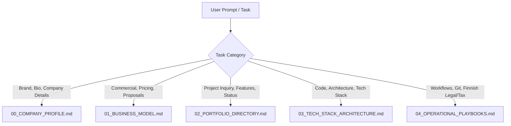

# Pomegroup Studio (Smart Monshi Oy) — Context Layer Index

> **Master Context Registry & Knowledge Layer**  
> **Company:** Smart Monshi Oy (Trade Name: Pomegroup Studio)  
> **Last Updated:** November 2026  
> **Audience:** AI Agents (Antigravity, Claude Code, Cursor, Copilot), Founders, Co-Founders, and Team Members.

---

## 📌 Overview

This directory (`context/`) forms the **canonical single source of truth** for Pomegroup Studio (legal entity: Smart Monshi Oy). It defines who we are, how we operate, our active portfolio, our technological standards, and our operational playbooks.

Whenever an AI agent or contributor begins a task across the monorepo, they should first consult this index and load the relevant context module.

---

## 🧭 Context Modules Sitemap

| Module | File | Primary Purpose | When to Reference |
| :--- | :--- | :--- | :--- |
| **00** | [00_COMPANY_PROFILE.md](file:///Users/mahdifarimani/Documents/AntiGravity/Pomegroup/context/00_COMPANY_PROFILE.md) | Corporate identity, legal facts, origin story, founder background, core philosophy | Onboarding, pitch decks, official representations, PRH/Vero inquiries, brand alignment |
| **01** | [01_BUSINESS_MODEL.md](file:///Users/mahdifarimani/Documents/AntiGravity/Pomegroup/context/01_BUSINESS_MODEL.md) | "Second Co-Founder as a Service", venture builder mechanics, equity + retainer models | Client proposals, partnership negotiations, GTM strategy, investor discussions |
| **02** | [02_PORTFOLIO_DIRECTORY.md](file:///Users/mahdifarimani/Documents/AntiGravity/Pomegroup/context/02_PORTFOLIO_DIRECTORY.md) | Registry of active ventures, paying retainer clients, upsell targets, and archived/exited projects | Cross-referencing projects, client status, upsell planning, architecture reviews |
| **03** | [03_TECH_STACK_ARCHITECTURE.md](file:///Users/mahdifarimani/Documents/AntiGravity/Pomegroup/context/03_TECH_STACK_ARCHITECTURE.md) | Engineering standards, frameworks (Next.js 16, Cloudflare, Telegram Bots, Python), coding rules | Feature development, code reviews, architectural planning, CI/CD setup |
| **04** | [04_OPERATIONAL_PLAYBOOKS.md](file:///Users/mahdifarimani/Documents/AntiGravity/Pomegroup/context/04_OPERATIONAL_PLAYBOOKS.md) | AI agent workflows, Loop Engineering, Finnish compliance (PRH, Vero, Soteri), Git conventions | Daily task execution, git commits, deploying services, legal/tax compliance |
| **05** | [05_BUSINESS_FINLAND_SPRINT_KB.md](file:///Users/mahdifarimani/Documents/AntiGravity/Pomegroup/context/05_BUSINESS_FINLAND_SPRINT_KB.md) | Master Business Finland Sprint Funding grant knowledge base, legal framework, rules & playbooks | Applying for BF Sprint grant (€100k), budgeting, procurement, auditing, venture building |

---

## 🤖 Context Selection Matrix for AI Agents

When executing a specific type of task, include or inspect the recommended context files:

### Quick Rules for AI Agents:
1. **Never guess personal data, founder history, or client details:** Consult [00_COMPANY_PROFILE.md](file:///Users/mahdifarimani/Documents/AntiGravity/Pomegroup/context/00_COMPANY_PROFILE.md) and [02_PORTFOLIO_DIRECTORY.md](file:///Users/mahdifarimani/Documents/AntiGravity/Pomegroup/context/02_PORTFOLIO_DIRECTORY.md).
2. **Never hallucinate tech stack availability:** Check [03_TECH_STACK_ARCHITECTURE.md](file:///Users/mahdifarimani/Documents/AntiGravity/Pomegroup/context/03_TECH_STACK_ARCHITECTURE.md) before recommending or installing libraries.
3. **Strict anti-fabrication:** Never generate synthetic headshots, fake personas, or synthetic testimonials for real living team members or partners.
